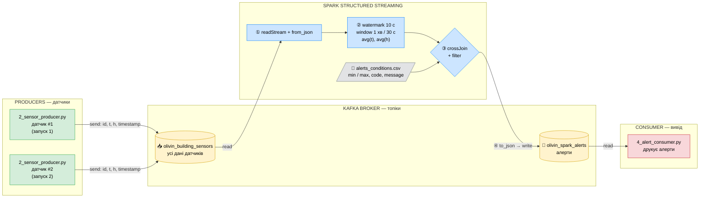
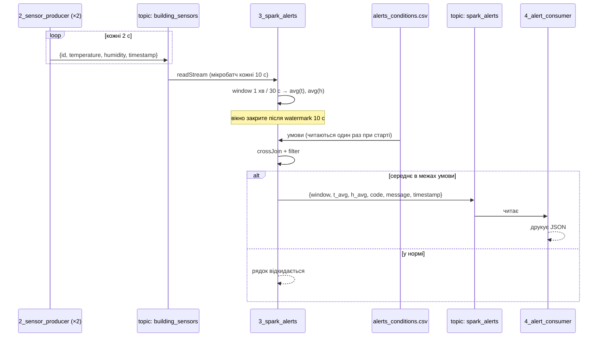
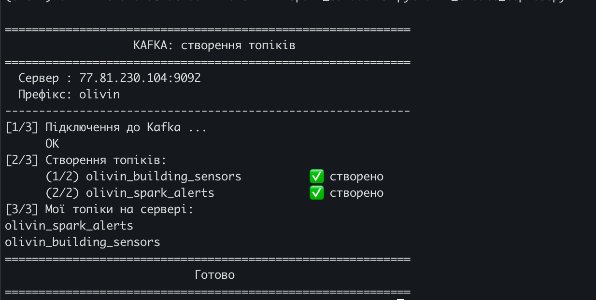
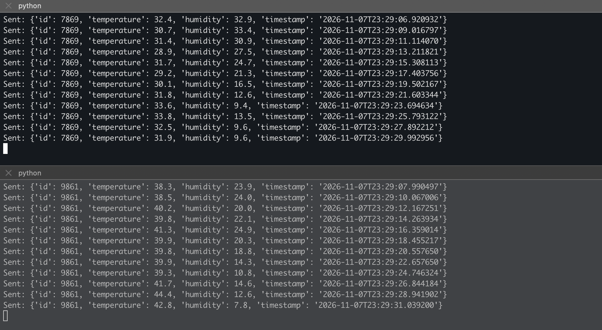
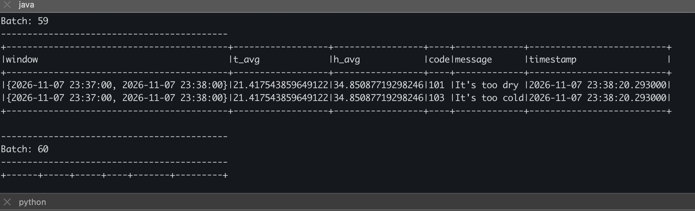
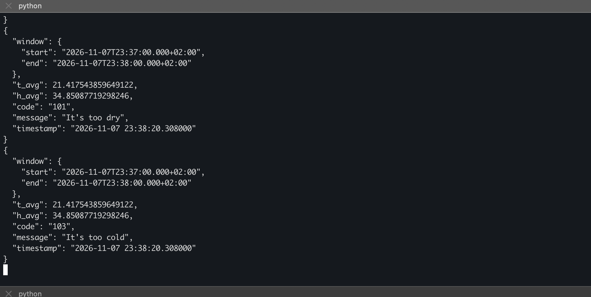
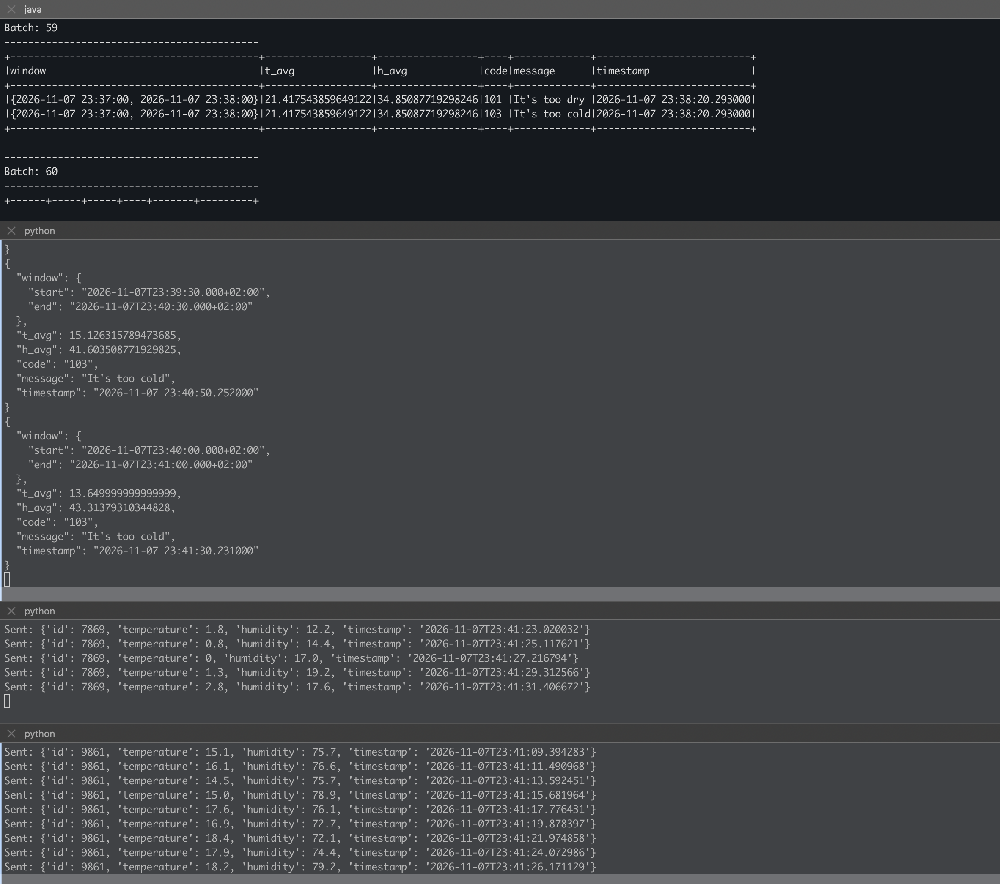

# Домашнє завдання: Spark Streaming (IoT-алерти)

Система збирає дані з датчиків температури та вологості, у реальному часі рахує середні значення в ковзному вікні за допомогою Spark Structured Streaming і записує алерти в окремий Kafka-топік. Критерії алертів зберігаються у файлі `alerts_conditions.csv` — їх можна змінити без зміни коду.

## Архітектура



**Що відбувається:**

1. **Producer** (`2_sensor_producer.py`) — кожен запуск = окремий датчик; кожні 2 с **записує** повідомлення `id, temperature, humidity, timestamp` у топік `building_sensors`.
2. **Spark** (`3_spark_alerts.py`) **читає** потік з `building_sensors`, розбирає JSON і групує дані у **ковзні вікна** довжиною 1 хв з кроком 30 с. Для кожного вікна рахує середню температуру `t_avg` і вологість `h_avg`.
3. **Watermark 10 с** — Spark чекає запізнілі дані ще 10 с після закінчення вікна, після чого вікно вважається закритим і результат більше не змінюється (режим `append`).
4. Середні значення об'єднуються з усіма рядками `alerts_conditions.csv` через **cross join**, а потім **фільтруються**: залишаються тільки ті пари, де середнє потрапило в діапазон `min..max` умови (`-999` = межа не перевіряється).
5. Знайдені алерти серіалізуються в JSON і **записуються** у топік `spark_alerts`; **consumer** (`4_alert_consumer.py`) читає їх і виводить на екран.

### Умови алертів (`alerts_conditions.csv`)

| code | вологість | температура | message |
|---|---|---|---|
| 101 | 0 – 40 | — | It's too dry |
| 102 | 60 – 100 | — | It's too wet |
| 103 | — | -300 – 30 | It's too cold |
| 104 | — | 40 – 300 | It's too hot |

### Ковзні вікна

Вікна по 1 хв зсуваються кожні 30 с і перекриваються, тому кожне повідомлення потрапляє у **два** вікна:

```mermaid
gantt
    dateFormat HH:mm:ss
    axisFormat %H:%M:%S
    section Вікна 1 хв / крок 30 с
    16:08:00 – 16:09:00 :w1, 16:08:00, 60s
    16:08:30 – 16:09:30 :w2, 16:08:30, 60s
    16:09:00 – 16:10:00 :w3, 16:09:00, 60s
    section Watermark
    +10 с — вікно 1 закривається :crit, 16:09:00, 10s
```



### Послідовність для одного вікна



| Файл | Призначення |
|---|---|
| `configs.py` | параметри підключення до Kafka (для kafka-python і для Spark) та імена топіків (префікс `olivin`) |
| `1_create_topics.py` | створює топіки `olivin_building_sensors` і `olivin_spark_alerts` та виводить їх список |
| `2_sensor_producer.py` | імітує один датчик: кожні 2 с шле `id`, `temperature` (0–60), `humidity` (0–100), `timestamp`; значення плавно «дрейфують», щоб середні виходили за межі |
| `3_spark_alerts.py` | Spark Streaming: window + watermark, середні, cross join з умовами, запис алертів у Kafka і в консоль |
| `4_alert_consumer.py` | читає топік алертів і виводить кожне повідомлення як JSON |
| `alerts_conditions.csv` | критерії алертів |

## Запуск

Середовище: Python 3.13, PySpark 4.2.0, Java 21 (`/opt/homebrew/opt/openjdk@21`), конектор `spark-sql-kafka-0-10_2.13:4.2.0`.

```bash
source .venv/bin/activate
pip install -r requirements.txt
python 1_create_topics.py
python 3_spark_alerts.py        # окремий термінал, запустити першим
python 4_alert_consumer.py      # окремий термінал
python 2_sensor_producer.py     # 2+ терміналів — кожен запуск = окремий датчик
```

## Результати

### 1. Створення топіків

`1_create_topics.py` підключається до Kafka і створює два топіки: `olivin_building_sensors` (дані датчиків) та `olivin_spark_alerts` (алерти). Обидва позначені «✅ створено», у блоці `[3/3]` — список моїх топіків на сервері.



### 2. Генерація даних двома датчиками одночасно → `building_sensors`

`2_sensor_producer.py` запущено двічі в різних терміналах — це два незалежні датчики з ID **7869** (верхня панель) і **9861** (нижня). Кожен кожні ~2 с надсилає в `olivin_building_sensors` ID, температуру, вологість і час. Час повідомлень збігається (`23:29:06`–`23:29:31`) — програми працюють одночасно.



### 3. Знаходження середніх і фільтрація алертів

`3_spark_alerts.py` виводить у консоль результат кожного мікробатчу. У `Batch: 59` для вікна **23:37:00 – 23:38:00** середні `t_avg ≈ 21.4` і `h_avg ≈ 34.9`. Після cross join з 4 умовами фільтр залишив **два** алерти: `101 It's too dry` (вологість у межах 0–40) і `103 It's too cold` (температура у межах -300–30). Алерт з'явився о `23:38:20` — це кінець вікна + watermark 10 с + інтервал тригера. Пустий `Batch: 60` — нових закритих вікон ще немає.



### 4. Запис алертів у Kafka-топік `spark_alerts`

`4_alert_consumer.py` читає `olivin_spark_alerts`: ті самі два алерти (`101` і `103`) для вікна 23:37:00 – 23:38:00, що й у консолі Spark, — тобто дані дійсно записані в Kafka. Формат повідомлень збігається з прикладом із завдання (`window`, `t_avg`, `h_avg`, `code`, `message`, `timestamp`).



Приклад повідомлення з топіку:

```json
{
  "window": {
    "start": "2026-11-07T22:43:00.000+02:00",
    "end": "2026-11-07T22:44:00.000+02:00"
  },
  "t_avg": 39.57692307692308,
  "h_avg": 16.05384615384616,
  "code": "101",
  "message": "It's too dry",
  "timestamp": "2026-11-07 22:44:11.855000"
}
```

### Загальний вигляд — усі 4 програми одночасно

Зверху вниз: Spark-обробник, читач алертів і датчики 7869 та 9861. У читачі видно ковзні вікна, що перекриваються: **23:39:30 – 23:40:30** і **23:40:00 – 23:41:00** (крок 30 с). Температура датчиків впала до ~0–18°C, тому обидва вікна дали `103 It's too cold` (`t_avg` 15.1 і 13.6), а вологість ~41–43% — у нормі, тому алертів за вологістю немає.



## Висновок

Реалізовано потоковий конвеєр на Spark Structured Streaming і Kafka:

- **генерація даних** — кілька незалежних датчиків одночасно пишуть у `building_sensors`;
- **агрегація** — sliding window 1 хв / 30 с з watermark 10 с рахує середні температуру й вологість; watermark обмежує стан Spark і дозволяє видавати остаточний результат вікна в режимі `append`;
- **фільтрація** — cross join середніх з умовами з CSV і фільтр за межами `min/max` (`-999` = не використовується); критерії змінюються редагуванням файлу без зміни коду;
- **запис у Kafka** — алерти у форматі JSON потрапляють у `spark_alerts` і читаються окремим consumer'ом.

На відміну від попереднього ДЗ (перевірка кожного повідомлення окремо), тут алерти формуються за **середніми значеннями у вікні часу** — одиничні викиди не спричиняють тривогу, а затримані дані коректно враховуються завдяки watermark.
